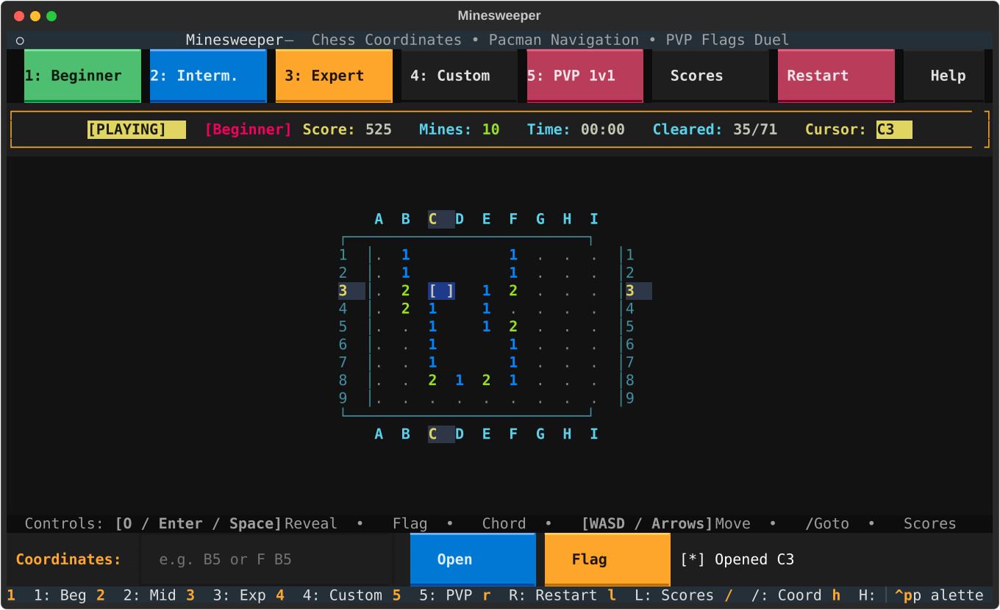

# Minesweeper Terminal & SSH

Play instantly from any terminal without installing Python (no password needed):

```bash
ssh -p 5822 play@minesweeper-ssh.duckdns.org
```

---



A clean, modern terminal Minesweeper built with Python and [Textual](https://github.com/Textualize/textual). Features chess coordinates, Pacman wrap-around navigation, real-time ranked online PVP matchmaking over SSH, persistent client fingerprint ranking, and low-latency rendering.

---

## Features

- **Real-time Ranked PVP Race**:
  - **Identical Seeded Map**: Both players are spawned onto the exact same minefield layout with identical mine placements.
  - **Classic Elimination**: Hitting a mine causes instant detonation and run loss (`[DETONATED]`). First-click mine relocation guarantees a safe opening move.
  - **Asynchronous Parallel Racing**: No turn waiting. Both players play independently in real time with live opponent telemetry: score, elapsed time, cells cleared, and current status (`[RACING]`, `[BOOM]`, `[CLEARED]`).
  - **Score & Speed Based Ranking**: Safe cells award combo points, accurate flags award +25 pts (-10 penalty for false flags), and full clear awards speed bonus points. Highest score wins (tiebroken by time).
  - **AI Practice Bot**: Press `B` in queue to race against an intelligent AI bot in real time.
  - **Client Fingerprint & Ranked Leaderboard**: Permanent win/loss statistics tied to your SSH machine tag (e.g. `#A4E2`). Winners enter their nickname into the Hall of Fame.
- **Singleplayer Classic**:
  - Classic rules with first-click safety, flood fills, chording (`C`), and high score tracking.
- **Board Difficulties**:
  - **Beginner**: 9x9, 10 mines
  - **Intermediate**: 16x16, 40 mines
  - **Expert**: 16x30, 99 mines
  - **Custom**: Configure your own width, height, and mine count via modal dialog.
  - **PVP Online**: 16x16, 40 mines ranked duel.
- **Chess Coordinates & Pacman Movement**:
  - Columns `A` -> `Z`, `AA` -> `...` and rows `1` -> `N` with active coordinate highlights.
  - Arrow keys or `WASD` navigation with toroidal wrap-around (walking off an edge loops to the opposite side).
  - Quick coordinate jump bar: type `B5` to open or `F B5` to flag.
- **Leaderboard & Match History**:
  - Saves top singleplayer high scores and ranked PVP champions in `leaderboard.json`.
  - Press `L` at any time to open the Hall of Fame.
- **Mouse & Keyboard Friendly**:
  - Full mouse support: left-click to open, right-click to flag.
  - Interactive top bar buttons and bottom command bar.

---

## Controls

| Key | Action |
|---|---|
| `Arrows` / `WASD` | Move cursor (Pacman wrap-around) |
| `O` / `Enter` / `Space` | Reveal cell (safe first click) |
| `F` | Toggle flag |
| `C` | Chord open around revealed number |
| `1` - `4` | Select difficulty (Beginner, Mid, Expert, Custom) |
| `5` | Start PVP Online matchmaking |
| `L` | View Leaderboard & Match History |
| `R` | Restart game |
| `/` | Focus coordinate input bar |
| `H` | Help screen |
| `Esc` | Return focus to board / cancel modal |
| `Ctrl+Q` / `Q` | Quit |

---

## Local Installation

Ensure you have Python 3.10+ installed.

Using `uv`:
```bash
uv run python main.py
```

Using standard `pip`:
```bash
pip install textual asyncssh
python main.py
```

Direct difficulty flags:
```bash
python main.py -d intermediate
python main.py -d expert
```

---

## Host Your Own SSH Server & PVP Hub

Run your own standalone Minesweeper SSH server and PVP hub:

```bash
# Start PVP matchmaking hub in background
python main.py --hub &

# Start SSH server on port 2222
python main.py --ssh --port 2222
```

Players can connect from any terminal:
```bash
ssh -p 2222 localhost
```

---

## Project Structure

```
minesweeper/
├── app.py                     # Main Textual application & state
├── fingerprint.py             # Client IP / machine fingerprint tag generator
├── game.py                    # Minesweeper logic, PVP engine, coordinate parser
├── hub.py                     # Authoritative PVP matchmaking hub server
├── leaderboard.py             # Singleplayer scores & ranked PVP profile persistence
├── pvp_client.py              # Async TCP client for real-time PVP duel
├── server.py                  # asyncssh PTY server for remote play
├── screens/
│   ├── custom_modal.py        # Custom dimensions dialog
│   ├── help_modal.py          # Hotkeys & PVP rules
│   ├── leaderboard_modal.py   # Hall of Fame: PVP rankings & singleplayer scores
│   ├── matchmaking_modal.py   # Ranked PVP matchmaking queue dialog
│   └── name_modal.py          # Victory nickname prompt
└── widgets/
    ├── board.py               # Grid renderer, opponent cursor & low-latency repaint
    ├── command_bar.py         # Chess coordinate input bar
    └── stats.py               # Turn indicator, player scores, timer & mine counters
```
